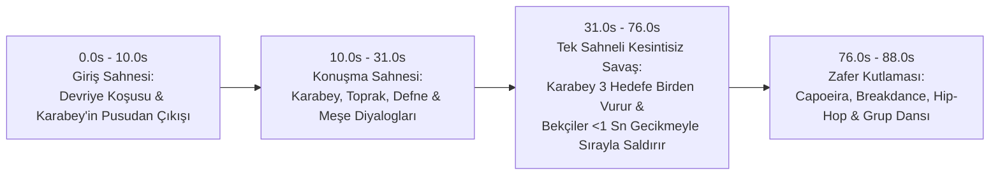

# Ormanın Bekçileri — Karakter Tanıtımı, Animasyon Kataloğu ve Senaryo Ekibi Kılavuzu

**Dizi / Proje Adı:** Ormanın Bekçileri  
**Ana Mekan:** Ulu Çınar Yolu (`models/maps/dirt-road.glb`)  
**Mevcut Bölümler:**
- **Bölüm 1 — İlk Devriye:** [`public/scenarios/bolum-1-ormanin-bekcileri.yaml`](file:///c:/Users/DELL/Desktop/VSRODevelopment/EYLUL2026/cartoon/public/scenarios/bolum-1-ormanin-bekcileri.yaml)
- **Bölüm 2 — Karabey'in Gölgesi:** [`public/scenarios/bolum-2-karabeyin-golgesi.yaml`](file:///c:/Users/DELL/Desktop/VSRODevelopment/EYLUL2026/cartoon/public/scenarios/bolum-2-karabeyin-golgesi.yaml)
- **Diyalog Örneği — Toprak Yol:** [`public/scenarios/harita-toprak-yol.yaml`](file:///c:/Users/DELL/Desktop/VSRODevelopment/EYLUL2026/cartoon/public/scenarios/harita-toprak-yol.yaml)

> **Senaryo Ekibi İçin Not:** Bu doküman, yazacağınız yeni bölüm senaryolarının (`.yaml`) motor şemasıyla ([`src/schema.ts`](file:///c:/Users/DELL/Desktop/VSRODevelopment/EYLUL2026/cartoon/src/schema.ts)) **%100 uyumlu** olması ve hiçbir teknik hata vermeden doğrudan çalıştırılabilmesi için gereken tüm karakter kimliklerini, boy ölçülerini, 102 yerleşik animasyon klibini, harita koordinatlarını ve YAML yazım kurallarını içerir.

---

## 1. Karakter Kadrosu ve Teknik Kimlik Tablosu

| Karakter Kimliği (`id`) | Adı | Element (`element`) | Unvanı / Rolü (`role`) | Sloganı (`tag`) | Boy (`height`) | Tema Rengi (`accent`) | 3B Model Kaynağı (`src`) | ElevenLabs Ses Kimliği (`voice`) |
| :--- | :--- | :---: | :--- | :--- | :---: | :---: | :--- | :--- |
| `toprak` | **Toprak** | **Toprak** (`toprak`) | Toprak Elementi · Meraklı Kaşif | *Ormanın Neşeli Lideri!* | `1.40 m` | `#16a34a` (Orman Yeşili) | `models/characters/main-character/kid.fbx` | `xDppd78rqTGY8ICN7M4n` |
| `defne` | **Defne** | **Hava** (`hava`) | Hava Elementi · Ormanın Gözcüsü | *Hiçbir Sır Gözünden Kaçmaz!* | `1.68 m` | `#db2777` (Canlı Pembe / Fuşya) | `models/characters/Jackie/character.fbx` | `o9DOmAyPjfFu8AfoFAnM` |
| `mese` | **Meşe** | **Su** (`su`) | Su Elementi · Ormanın Okçusu ve Bilgesi | *Su Oklarıyla Ormanı Korur!* | `1.72 m` | `#d97706` (Kehribar / Altın Sarısı) | `models/characters/Erika/character.fbx` | `KAGDtM2gzDrjWlUp2KNe` |
| `karabey` | **Karabey** | **Ateş** (`ates`) | Ateş Elementi · Ormanın Düşmanı | *Ormanın Gölgesi Her Yerde! Bu Orman Benim Olacak!* | `1.95 m` | `#991b1b` (Koyu Kızıl / Karanlık) | `models/characters/sword-and-shield/Paladin WProp J Nordstrom.fbx` | `mF7tIc9VLrznhGooGjaT` |

> **Element kuralı:** Her karakter yalnızca kendi elementinin yeteneklerini kullanır. Senaryoda karakter varlığına `element: toprak` gibi yazılır; başka elementten bir yetenek kullanırsa motor yüklemede uyarı verir. Yeteneklerin elementi ve zamanlaması [`src/data/abilities.yaml`](src/data/abilities.yaml) dosyasındadır (tek kaynak).

---

## 2. Detaylı Karakter Profilleri

### 2.1. Toprak (`toprak`) — Meraklı Kaşif ve Yol Gösterici
- **Boy:** `1.40 m`
- **Görünüm:** Şapkalı, sırt çantalı, yeşil doğa kıyafetli genç kaşif.
- **Kişilik:** Enerjik, cesur, sabah sporunu aksatmayan ve ekibi bir araya getiren doğal liderdir. Yeni patikaları keşfetmeyi, taktik vermeyi (`point`) ve akrobatik hareketlerle (`pushup`, `capoeira`, `flair`, `breakdance`) moral yükseltmeyi sever.
- **Elementi:** Toprak.
- **Özel Yeteneği (`do: ability`):**
  - **`yer_dikeni` (`toprak_dikeni` / `kaya_dikeni` / `earth_spikes`) — Yer Dikenleri:** Kollarını gererek güç toplar (`stretch`, `1.0s`), çevresinde yerden taşçıklar yükselir; diz çöküp yere dokunduğu anda (`point`, `1.35s`) ondan hedefe doğru sırayla yerden kaya dikenler fışkırır ve dalga gibi ilerler. **İsabette (`2.10s`)** hedefin altında üç büyük diken, toz bulutu ve taş parçaları çıkar; hedef savrulur.
- **Standart İsim Kartı (`lower_third`):**
  ```yaml
  - type: lower_third
    at: 26.5
    duration: 6.5
    name: "TOPRAK"
    role: "Toprak Elementi · Meraklı Kaşif"
    tag: "Ormanın Neşeli Lideri!"
    accent: "#16a34a"
    align: left
  ```

### 2.2. Defne (`defne`) — Ormanın Keskin Gözcüsü
- **Boy:** `1.68 m`
- **Görünüm:** Atletik yapılı, pembe saçlı ve spor kıyafetli çevik gözcü.
- **Kişilik:** Hızlı refleksleri, keskin gözlemi ve korkusuz duruşuyla ekibin koruyucu kalkanıdır. Tehlike anında en önde yer alır; hip-hop dansıyla (`hip_hop`) kutlamalara renk katar.
- **Elementi:** Hava.
- **Özel Yeteneği (`do: ability`):**
  - **`ruzgar_hortumu` (`hortum` / `wind_tornado` / `kasirga_tufani` / `whirlwind_kick`) — Rüzgar Hortumu:** Tornado Defne'nin **tam içinde** oluşana kadar (`2.25s`) `hurricane_kick` döner; hedefe gönderirken `flying_kick` ile çift katmanlı 3B hortum Defne'nin içinden düşmana fırlar (**isabet `3.05s`**), düşmanı havaya kaldırıp savurur. (`kasirga_tufani` artık aynı yeteneğin takma adıdır.)
- **Standart İsim Kartı (`lower_third`):**
  ```yaml
  - type: lower_third
    at: 40.4
    duration: 3.6
    name: "DEFNE"
    role: "Hava Elementi · Ormanın Gözcüsü"
    tag: "Hiçbir Sır Gözünden Kaçmaz!"
    accent: "#db2777"
    align: right
  ```

### 2.3. Meşe (`mese`) — Kadim Sırların Bilgesi (Erika — Elinde Yay Olan Okçu Modeli)
- **Boy:** `1.72 m`
- **Görünüm:** Sol elinde 3B yay (`Erika_Archer_Bow_Mesh` / `Bow_MAT`) taşıyan, okçu kıyafetli (`Erika_Archer_Clothes_Mesh`) ve Pro Longbow animasyon paketine sahip çevik orman okçusu (`models/characters/Erika/character.fbx`).
- **Kişilik:** Ormanın kadim geçmişini, ağaçların dilini ve Ulu Çınar'ın fısıltılarını dinleyebilen bilge okçudur. Neşeli zıplayışları (`jump_joy`), şarkı söylemesi (`singing`) ve okçu duruşlarıyla ekibin kalbidir.
- **Elementi:** Su.
- **Özel Yeteneği (`do: ability`):**
  - **`firtina_oku` (`yagmur_oku` / `su_oku` / `rain_arrow` / `yagmur` …) — Sağanak Oku:** Yayına ok yerleştirir (`draw_arrow`), sol elindeki yayda su enerjisi toplar (`aim_overdraw`); kirişi bıraktığı anda (`aim_recoil`, **`2.17s`**) büyülü su oku sol elinden çıkar. **İsabette (`2.80s`)** hedefin tepesinde fırtına bulutu, şimşek ve sağanak yağmur başlar, hedef savrulur.
- **Standart İsim Kartı (`lower_third`):**
  ```yaml
  - type: lower_third
    at: 54.0
    duration: 5.5
    name: "MEŞE"
    role: "Su Elementi · Ormanın Okçusu ve Bilgesi"
    tag: "Ulu Çınarın En Yakın Dostu!"
    accent: "#d97706"
    align: left
  ```

### 2.4. Karabey (`karabey`) — Karanlık Muhafız ve Ormanın Düşmanı
- **Boy:** `1.95 m` (`1.90 m - 2.00 m` aralığında, serideki tüm karakterlerden belirgin biçimde uzun ve heybetli)
- **Görünüm:** Tam takım ağır şövalye zırhı, miğferi, sol elinde kalkanı ve sağ elinde kılıcıyla donanmış karanlık muhafız.
- **Kişilik:** Ormanın kadim dengesini bozmak ve Ulu Çınar'ın gücünü ele geçirmek isteyen baş düşmandır.
- **Elementi:** Ateş.
- **Özel Yetenekleri (`do: ability`):**
  - **`alev_buyusu` (`ates_buyusu` / `ates_firtinasi` / `fire_spell`) — Alev Büyüsü:** Büyü toplar (`casting`), elinde büyüyen ateş topunu kılıç saldırısıyla (`attack_2`, **`2.12s`**) fırlatır; **isabet `2.74s`**. `target` bir liste verilirse (ör. `[toprak, defne, mese]`) her hedefe aynı anda ayrı bir ateş topu gider (Ateş Fırtınası).
  - **`agac_devirme` (`tree_fall`) — Ağaç Devirme:** Güç toplar (`power_up`), kızgın yatay kılıç darbesiyle (`slash_2`, kesik `1.65s`) haritadaki çamı (`target: Realistic_Pine_057` gibi) keser; ağaç devrilip **`2.38s`'de** yere çarpar ve yerde kalır. Hedef karakter gerektirmez.
  - *Eski gölge yetenekleri (`golge_kilic`, `karanlik_buyu`) motor tarafından hâlâ tanınır ama elementsizdir (`golge`); Ormanın Bekçileri'nde kullanılmaz, Karabey kullanırsa uyarı verilir.*
- **Standart İsim Kartı (`lower_third`):**
  ```yaml
  - type: lower_third
    at: 10.5
    duration: 9.0
    name: "KARABEY"
    role: "Ateş Elementi · Ormanın Düşmanı"
    tag: "Ormanın Gölgesi Her Yerde! Bu Orman Benim Olacak!"
    accent: "#991b1b"
    align: left
  ```

---

## 2.5. Karakter Özel Yetenekleri Tablosu (`do: ability`)

> **Zorunlu Senaryo ve Kamera Kuralı:**
> 1. **Sadece Yetenekle Saldırı:** Senaryolarda karakterler birbirine **yalnızca `do: ability` komutunu kullanarak saldırır**. Tek başına ham saldırı klipleri (`do: clip, name: kick` vb.) doğrudan saldırı amacıyla kullanılmaz.
> 2. **Eş Zamanlı (Aynı Anda Birden Fazla) Yetenek Kullanımı:** Dövüş sahnelerinde 2 veya 3 karakter **aynı anda (`at` zamanları çakışacak veya çok yakın olacak şekilde) `do: ability` kullanabilir**. Motor tüm eş zamanlı yetenekleri aynı anda işler, kamera tüm aktif yetenekleri ve hedefleri tek bir dinamik kadrajda birleştirir, savrulmalar (`knockback`) ise vuruş anına (`impactTime`) göre sırayla uygulanır.
> 3. **Otomatik Yetenek Kamerası Yaklaşımı:** Tekli yetenek kullanımının başında kamera otomatik olarak **yeteneği kullanan karaktere yaklaşır (ancak yetenek efekti kadrajda tam görünür kalacak mesafede tutulur)**, eş zamanlı yeteneklerde ise tüm aktif yetenekleri kapsayan geniş aksiyon açısına geçer.

| Yetenek Kodu (`name`) | Element | Karakter (`who`) | Klipler | Zamanlama (yetenek başından) | Görsel Efekt | Varsayılan Tepki (`impact_clip`) |
| :--- | :---: | :---: | :--- | :--- | :--- | :--- |
| `alev_buyusu` | Ateş | `karabey` | `casting` (`1.30s`) + `attack_2` | fırlatma `2.12s`, isabet `2.74s`, bitiş `4.04s` | 3B magma çekirdeği + alev koronası, kıvılcım ve is; çoklu hedefte her hedefe bir top | `impact_3` |
| `agac_devirme` | Ateş | `karabey` | `power_up` (`1.15s`) + `slash_2` (`1.65s`) | kesik `1.65s`, ağacın yere çarpması `2.38s` | Kızgın kılıç kesiği, haritadaki çam devrilir, yerde kalır | (hedef yok) |
| `yer_dikeni` | Toprak | `toprak` | `stretch` (`1.0s`) + `point` (`1.85s`) | dikenler `1.35s`, isabet `2.10s`, bitiş `3.25s` | Yerden sırayla fışkıran kaya dikenler, hedefte üç büyük diken, toz ve taş parçaları | `impact_3` |
| `ruzgar_hortumu` | Hava | `defne` | `hurricane_kick` (`2.25s`, döngü) + `flying_kick` (`1.65s`) | fırlatma `2.25s`, isabet `3.05s`, bitiş `4.35s` | Defne'nin içinde oluşan çift katmanlı 3B hortum | `impact_2` |
| `firtina_oku` | Su | `mese` | `draw_arrow` + `aim_overdraw` (`1.0s`) + `aim_recoil` | ok `2.17s`, isabet `2.80s`, bitiş `4.70s` | Su kristali temrenli ok, hedefte fırtına bulutu, şimşek, sağanak | `impact_3` |

Tüm takma adlar, savrulma yayları ve klip süreleri [`src/data/abilities.yaml`](src/data/abilities.yaml) dosyasındadır; buradaki tablo özettir. `knockback` (savrulma mesafesi) senaryoda verilir, varsayılan `4.0 m`. Örnek kullanım için [`public/scenarios/test-dort-element.yaml`](public/scenarios/test-dort-element.yaml) (seslendirmesiz test bölümü) ve [`public/scenarios/bolum-2-karabeyin-golgesi.yaml`](public/scenarios/bolum-2-karabeyin-golgesi.yaml).

---

## 3. Tüm Karakterler İçin Yerleşik Animasyon Kataloğu (107 Klip)

Motorumuz ([`src/schema.ts`](file:///c:/Users/DELL/Desktop/VSRODevelopment/EYLUL2026/cartoon/src/schema.ts)) aşağıda listelenen **107 animasyon klibini** otomatik olarak tanır. Senaryo yazarken `do: clip, name: <klip_kodu>` veya `do: walk_to, clip: <klip_kodu>` şeklinde doğrudan kullanabilirsiniz.

### 3.1. Genel Karakter Animasyonları (`SHARED_MIXAMO_ANIMATIONS` — 58 Adet)
*Toprak, Defne, Meşe ve Karabey dahil tüm karakterlerde doğrudan kullanılabilir.*

#### A) Temel Duruş, Yürüyüş ve Koşu (`walk_to` veya `clip` ile kullanılır)
| Klip Kodu (`name` / `clip`) | Kategori | Açıklama / Kullanım Amacı | Kaynak Dosya (`public/models/...`) |
| :--- | :--- | :--- | :--- |
| `idle` | Duruş | Doğal nefes alma ve bekleme duruşu (Varsayılan) | `characters/main-character/animations/Neutral Idle.fbx` |
| `fight_idle` | Duruş | Normal duruştan tetikte dövüş/savunma duruşuna geçiş | `characters/main-character/animations/Action Idle To Fight Idle.fbx` |
| `briefcase_idle` | Duruş | Dikkatli / nöbetçi bekleme duruşu | `characters/main-character/animations/Standing W_Briefcase Idle.fbx` |
| `sitting` | Duruş | Yerde/taşta dinlenerek oturma | `characters/main-character/animations/Sitting.fbx` |
| `crouch_to_stand` | Geçiş | Çömelmiş/gizlenmiş pozisyondan ayağa kalkma | `characters/main-character/animations/Crouch To Stand.fbx` |
| `walk` | Yürüyüş | Standart rahat yürüyüş (`speed: 1.1 - 1.3`) | `characters/main-character/animations/Walking.fbx` |
| `drunk_walk` | Yürüyüş | Sersemlemiş / yorgun / sendeleyerek yürüyüş | `characters/main-character/animations/Drunk Walk.fbx` |
| `jog` | Koşu | Tempolu hafif koşu (`speed: 1.5 - 1.8`) | `characters/main-character/animations/Jogging.fbx` |
| `run` | Koşu | Tam hız depar / hızlı koşu (`speed: 1.8 - 2.6`) | `characters/main-character/animations/Running.fbx` |
| `run_forward` | Koşu | Atik ileri koşu | `characters/main-character/animations/Standing Run Forward.fbx` |
| `run_arc_left` | Koşu | Sola kavis çizerek koşu | `characters/main-character/animations/Run Forward Arc Left.fbx` |
| `run_to_turn` | Koşu | Koşarken ani dönüş hareketi | `characters/main-character/animations/Running To Turn.fbx` |
| `turn_left` | Dönüş | Olduğu yerde sola dönüş | `characters/main-character/animations/Left Turn.fbx` |
| `turn_right` | Dönüş | Olduğu yerde sağa dönüş | `characters/main-character/animations/Right Turn.fbx` |
| `rifle_turn` | Dönüş | Hızlı ve keskin gözcü dönüşü | `characters/main-character/animations/Rifle Turn.fbx` |
| `swimming` | Hareket | Yüzme / kulaç atma hareketi | `characters/main-character/animations/Swimming.fbx` |

#### B) Zıplama, Spor ve Akrobasi
| Klip Kodu (`name`) | Kategori | Açıklama / Kullanım Amacı | Kaynak Dosya (`public/models/...`) |
| :--- | :--- | :--- | :--- |
| `jump` | Zıplama | Standart ileri/yukarı sıçrama | `characters/main-character/animations/Jump.fbx` |
| `jump_joy` | Zıplama | Kolları açarak neşeli sevinç sıçrayışı (Meşe'nin imzası) | `characters/main-character/animations/Joyful Jump.fbx` |
| `running_jump` | Zıplama | Koşarak engelin üzerinden atlama | `characters/main-character/animations/Running Jump.fbx` |
| `jump_down` | Zıplama | Yüksek bir yerden aşağı atlama ve dengeli iniş | `characters/main-character/animations/Jumping Down.fbx` |
| `pushup` | Spor | Zıplayarak alkışlı şınav çekme (Toprak'ın imzası) | `characters/main-character/animations/Jump Push Up.fbx` |
| `bicycle_crunch` | Spor | Yerde mekik / bisiklet egzersizi | `characters/main-character/animations/Bicycle Crunch.fbx` |
| `stretch` | Spor | Kol ve omuz esnetme / ısınma hareketi | `characters/main-character/animations/Arm Stretching.fbx` |
| `goalkeeper` | Akrobasi | Kaleci gibi yana uçarak yakalama / kurtarış hamlesi | `characters/main-character/animations/Goalkeeper Catch.fbx` |

#### C) Dövüş, Savunma ve Aksiyon
| Klip Kodu (`name`) | Kategori | Açıklama / Kullanım Amacı | Kaynak Dosya (`public/models/...`) |
| :--- | :--- | :--- | :--- |
| `hook_punch` | Saldırı / Yetenek | Güçlü sağ kroşe yumruk (genel `ates_topu` yeteneğinin animasyonu) | `characters/main-character/animations/Hook Punch.fbx` |
| `hurricane_kick` | Saldırı / Yetenek | Kasırga dönüşlü tekme (`ruzgar_hortumu` ve `kasirga_tufani` yeteneklerinde tornado oluşana kadar döner) | `characters/main-character/animations/Hurricane Kick.fbx` |
| `flying_kick` | Saldırı | Havada ileri süzülerek uçan tekme darbesi (Tornado hedefe gönderilirken kullanılır) | `characters/main-character/animations/Flying Kick.fbx` |
| `chapa_giratoria` | Saldırı | 360 derece dönerek sert taban tekmesi (Chapa Giratoria) | `characters/main-character/animations/Chapa-Giratoria.fbx` |
| `macaco_side` | Akrobasi / Savunma | Yana doğru tek elle akrobatik Macaco sıçrayışı / kaçınma | `characters/main-character/animations/Macaco Side.fbx` |
| `kick` | Saldırı | Havada döner tekme (Martelo 2) | `characters/main-character/animations/Martelo 2.fbx` |
| `mma_kick` | Saldırı | Güçlü MMA yan döner tekme | `characters/main-character/animations/Mma Kick.fbx` |
| `rifle_kick` | Saldırı | Dönerek savunma tekmesi | `characters/main-character/animations/Rifle Turn And Kick.fbx` |
| `dodge_back` | Savunma | Saldırıdan geriye doğru çevik sıçrayışla kaçınma | `characters/main-character/animations/Standing Dodge Backward.fbx` |

#### D) Dans, Kutlama ve Sahne Şovu
> **Önemli Senaryo Kuralı:** Bu kategorideki animasyonlar (`dance`, `capoeira`, `hip_hop`, `breakdance`, `flair`, `singing`) **yalnızca dans, eğlence ve zafer kutlaması sahnelerinde** kullanılır; **düşmana karşı saldırı veya düello hareketi olarak kesinlikle kullanılamaz.**

| Klip Kodu (`name`) | Kategori | Açıklama / Kullanım Amacı | Kaynak Dosya (`public/models/...`) |
| :--- | :--- | :--- | :--- |
| `dance` / `silly_dance` | Dans | Eğlenceli çizgi film zafer dansı (Grup kutlaması) | `characters/main-character/animations/Silly Dancing.fbx` |
| `capoeira` | Dans | Ritmik Capoeira dans gösterisi (Yalnızca dans/kutlama sahnelerinde kullanılır; düşmana karşı kullanılamaz) | `characters/main-character/animations/Capoeira.fbx` |
| `hip_hop` | Dans | Dinamik Hip-Hop sokak dansı | `characters/main-character/animations/Hip Hop Dancing.fbx` |
| `breakdance` | Dans | 1990 stil dönüşlü Breakdance şovu | `characters/main-character/animations/Breakdance 1990.fbx` |
| `flair` | Dans | Yerde değirmen (Flair) dans dönüşü | `characters/main-character/animations/Flair.fbx` |
| `singing` | Şov | Duygulu ve neşeli şarkı söyleme performansı | `characters/main-character/animations/Singing.fbx` |

#### E) Tepki, Jest ve Dramatik Durumlar
| Klip Kodu (`name`) | Kategori | Açıklama / Kullanım Amacı | Kaynak Dosya (`public/models/...`) |
| :--- | :--- | :--- | :--- |
| `taunt` | Jest | Meydan okuma / kendine güvenen cesur duruş | `characters/main-character/animations/Taunt.fbx` |
| `point` | Jest | Tek diz çökerek ilerideki hedefi/izi işaret etme | `characters/main-character/animations/Kneeling Pointing.fbx` |
| `surprised` | Tepki | Elleri başa götürerek büyük şaşkınlık / hayret tepkisi | `characters/main-character/animations/Surprised.fbx` |
| `defeated` | Tepki | Hayal kırıklığı, yorgunluk veya yenilgiyi kabul etme | `characters/main-character/animations/Defeated.fbx` |
| `fall_flat` | Komedi | Yüzüstü yere kapaklanma (Slapstick çizgi film düşüşü) | `characters/main-character/animations/Fall Flat.fbx` |
| `dying` | Dramatik | Bayılma / yere yığılma | `characters/main-character/animations/Dying.fbx` |
| `death_left` | Dramatik | Sola doğru savrularak yere düşme | `characters/main-character/animations/Standing Death Left 01.fbx` |

#### F) İzcilik / Okçu (`Longbow`) Hareket Paketi
| Klip Kodu (`name` / `clip`) | Açıklama / Kullanım Amacı | Kaynak Dosya (`public/models/...`) |
| :--- | :--- | :--- |
| `bow_idle` | Gözcü / okçu tetikte bekleme duruşu | `.../Longbow Locomotion Pack/standing idle 01.fbx` |
| `bow_walk` / `bow_walk_back` | İleri / geri dikkatli iz sürme yürüyüşü | `.../Longbow Locomotion Pack/standing walk forward/back.fbx` |
| `bow_walk_left` / `bow_walk_right` | Sola / sağa yan adımlarla iz sürme yürüyüşü | `.../Longbow Locomotion Pack/standing walk left/right.fbx` |
| `bow_run` / `bow_run_stop` | İleri izci koşusu ve ani duruş | `.../Longbow Locomotion Pack/standing run forward (stop).fbx` |
| `bow_run_back` / `bow_run_left` / `bow_run_right` | Geriye / sola / sağa çevik izci koşusu | `.../Longbow Locomotion Pack/standing run back/left/right.fbx` |
| `bow_turn_left` / `bow_turn_right` | 90 derece sola / sağa izci dönüşü | `.../Longbow Locomotion Pack/standing turn 90 left/right.fbx` |

---

### 3.2. Karabey (`sword-and-shield`) Özel Savaşçı Animasyon Kataloğu (49 Adet)
*`karabey` karakterine otomatik olarak bağlıdır; kılıç ve kalkan koreografilerinde kullanılır.*

| Kategori | Kullanılabilir Klip Kodları (`name` / `clip`) | Açıklama ve Koreografi Notları |
| :--- | :--- | :--- |
| **Muhafız Duruşları** | `idle`, `idle_2`, `idle_3`, `idle_4` | Kılıç ve kalkanla 4 farklı nefes alma, etrafı süzme ve nöbet duruşu. |
| **Zırhlı Yürüyüş & Koşu** | `walk`, `walk_2`, `run`, `run_2` | Kalkan önde ağır muhafız yürüyüşü (`walk`, `walk_2`) ve hücum koşusu (`run`, `run_2`). |
| **Yan Adım & Dönüşler** | `strafe`, `strafe_2`, `strafe_3`, `strafe_4`, `turn`, `turn_2`, `turn_180`, `turn_180_2` | Düello sırasında rakibin etrafında yan adımlarla dönme ve 180 derece ani arkaya dönüşler. |
| **Kılıç Savurma (`slash`)** | `slash`, `slash_2`, `slash_3`, `slash_4`, `slash_5` | 5 farklı açıda geniş ve görkemli kılıç savurma komboları. |
| **Saldırı & Tekme (`attack`)** | `attack`, `attack_2`, `attack_3`, `attack_4`, `kick`, `jump`, `jump_2` | İleri atılarak kılıç/kalkan darbesi, zırhlı tekme (`kick`) ve sıçrayarak saldırı (`jump`). |
| **Kalkan Savunması (`block`)** | `block`, `block_2`, `block_idle` | Gelen darbeyi kalkanla karşılama (`block`, `block_2`) ve kalkan arkasında siper alma (`block_idle`). |
| **Pusu & Çömelme (`crouch`)** | `crouch`, `crouch_idle`, `crouch_block`, `crouch_block_2`, `crouch_block_idle`, `crouching`, `crouching_2`, `crouching_3` | Ormanda pusuya yatma, çömelerek kalkan tutma ve gizlice ilerleme. |
| **Güç, Büyü & Kın (`power_up`)** | `power_up`, `casting`, `casting_2`, `sheath`, `sheath_2` | Gökyüzüne kılıç kaldırıp güç toplama (`power_up`), karanlık gölge büyüsü (`casting`) ve kılıcı kınına sokma/çekme (`sheath`). |
| **Sarsılma & Yenilgi (`impact`)** | `impact`, `impact_2`, `impact_3`, `death`, `death_2` | Bekçilerin hamleleriyle sarsılma/geriye sendeleme (`impact_1..3`) ve yere yıkılma (`death`). |

---

## 4. Senaryo Ekibi İçin Teknik Yazım Kuralları (YAML Şema Rehberi)

### 4.1. Hazır Senaryo Başlangıç Şablonu (`film` ve `assets`)
Her yeni bölüm dosyasının (`public/scenarios/bolum-X-....yaml`) en üstünde aşağıdaki standart blok yer almalıdır:

```yaml
film:
  title: bolum-2-karabeyin-golgesi
  fps: 30
  fade_in: 0.6
  fade_out: 1.5
  handheld: 0.14
  music:
    src: /audio/main-theme/jyproject-carousel-dreams-396029.mp3
    volume: 0.35
    ducking: 0.25
    loop: true
    fade_in: 0.5
    fade_out: 1.5

assets:
  toprak:
    src: models/characters/main-character/kid.fbx
    height: 1.4
    voice: xDppd78rqTGY8ICN7M4n
  defne:
    src: models/characters/Jackie/character.fbx
    height: 1.68
    voice: o9DOmAyPjfFu8AfoFAnM
  mese:
    src: models/characters/Erika/character.fbx
    height: 1.72
    voice: KAGDtM2gzDrjWlUp2KNe
  karabey:
    src: models/characters/sword-and-shield/Paladin WProp J Nordstrom.fbx
    height: 1.95
    voice: mF7tIc9VLrznhGooGjaT
  harita:
    src: models/maps/dirt-road.glb
    align: none
```

### 4.2. Bağımsız Kamera (`cameras`) ve Kesintisiz Eylem (`actions`) Mimarisi
- Sahnelerde kamera kesmeleri `cameras:` listesinde, karakterlerin tüm hareket ve diyalogları ise `actions:` listesinde tanımlanır.
- **Çok Önemli:** Kamera geçişleri (`cameras`) karakter animasyonlarını **bölmez veya sıfırlamaz**. Bir karakter `at: 0.2` saniyede koşmaya başlayıp `at: 20.0` saniyeye kadar koşarken, kamera `11.0` saniyede başka bir açıya geçse bile karakter koşusuna kesintisiz devam eder.
- Tüm `at:` zaman değerleri sahnenin başlangıcına (`0.0` saniye) göre saniye cinsinden yazılır.

### 4.3. Karakter Eylem (`actions`) Komutları Referansı

1. **Yürüme ve Koşma (`do: walk_to`):**
   - Tek bir noktaya `[x, z]` veya duraksamadan geçilecek çoklu yol noktalarına (`[[x1, z1], [x2, z2], ...]`) hareket sağlar.
   - `speed` (m/sn) veya toplam `duration` (sn) verilebilir.
   - `clip` parametresine `walk`, `jog`, `run`, `drunk_walk`, `run_2` vb. yazılabilir.
   ```yaml
   - who: toprak
     do: walk_to
     to:
       - [26.0, 42.5]
       - [14.0, 42.5]
     speed: 1.9
     clip: run
     at: 0.5
   ```

2. **Özel Animasyon Oynatma (`do: clip`):**
   - Katalogdaki 102 klipten herhangi birini oynatır. Süre bitiminde karakter `fade` süresiyle yumuşakça `idle` duruşuna döner.
   ```yaml
   - who: karabey
     do: clip
     name: power_up
     at: 11.5
     duration: 3.4
     loop: false
     fade: 0.3
   ```

3. **Konuşma ve Seslendirme (`do: talk`):**
   - Karakter konuşurken çene/ağız hareketi ve çizgi film konuşma efekti otomatik çalışır; arka plan müziği `ducking` oranında otomatik kısılır.
   ```yaml
   - who: toprak
     do: talk
     at: 26.8
     duration: 6.56
     text: "Merhaba! Ben Toprak. Ormanın meraklı kaşifi ve Bekçiler ekibinin yol göstericisiyim!"
     audio: audio/bolum-1-ormanin-bekcileri/toprak_shot1_4.mp3
   ```

4. **Bakış Yönlendirme (`do: look_at`) ve Dönme (`do: turn`):**
   - `look_at`: Karakterin başını/gövdesini kameraya (`target: camera`), başka bir karaktere (`target: karabey`) veya bir koordinata (`target: [10, 1, 42]`) çevirir.
   - `turn`: Karakterin baktığı yönü derece cinsinden (`to: 90`) veya başka bir karaktere (`to: toprak`) döndürür.
   ```yaml
   - who: defne
     do: look_at
     target: camera
     at: 38.4
     duration: 7.0
   ```

5. **El Sallama (`do: wave`), Zıplama (`do: jump`) ve Yüz İfadesi (`do: emote`):**
   ```yaml
   - who: toprak
     do: wave
     hand: right
     at: 26.2
     duration: 1.8
   ```

6. **Özel Yetenek Kullanımı (`do: ability`) — Tekli ve Çoklu Hedef Desteği:**
   - Animasyonlar, 3B hacimsel shader yetenek ağları (`alev_buyusu`, `agac_devirme`, `yer_dikeni`, `ruzgar_hortumu`, `firtina_oku`), dinamik ışık ve hedeflerin geriye savrulması (`knockback`) tek bir komutla otomatik çalışır.
   - `target` alanı tek bir karakter kimliği (`target: karabey`) veya aynı anda birden fazla hedefe vuran bir liste (`target: [toprak, defne, mese]`) alabilir:
   ```yaml
   # Çoklu hedef örneği: Karabey'in Alev Büyüsü üç hedefe de aynı anda birer ateş topu gönderir
   - who: karabey
     do: ability
     name: alev_buyusu
     target:
       - toprak
       - defne
       - mese
     at: 31.2
     knockback: 0.25
     impact_clip: dodge_back

   # Tekli hedef örneği: Defne'nin Rüzgar Hortumu (Hurricane Kick ile içinde oluşur ve Karabey'e fırlar)
   - who: defne
     do: ability
     name: ruzgar_hortumu
     target: karabey
     at: 36.8
     knockback: 0.40
     impact_clip: impact_2
   ```

### 4.4. Kamera (`cameras`) ve Çizgi Film Geçişleri (`transition`)
- **Geçiş Tipleri (`transition`):**
  - `cut`: Anında kesme (varsayılan)
  - `stripes`: Çizgi film tarzı renkli diyagonal hız şeritleri geçişi
  - `iris`: Klasik çizgi film yıldız/daire kapanıp açılma geçişi
  - `flash`: Aksiyon ve düello sahneleri için parlak flaş geçişi
  - `fade`: Yumuşak kararma geçişi
- **Kamera Hedefi (`target`):**
  - Tek karakter (`target: karabey`), grup (`target: [toprak, defne, mese]`) veya uçuş yolu (`target: [[79, 10.5, -16], [58, 16.0, 42.5], ...]`) olabilir.
- **Kamera Mesafesi (`size`) ve Açılar (`angle`, `elevation`):**
  - Sabit (`size: medium`, `angle: 20`) veya hareketli (`size: { from: 3.2, to: 1.8 }`, `angle: { from: -20, to: 15 }`) tanımlanabilir.
  - `relative: true` verildiğinde `angle: 0` karakterin tam karşısını (yüzünü), `angle: 180` ise tam arkasını gösterir.

### 4.5. Çizgi Film Grafik Katmanları (`overlays`)
Sahneye enerjik çizgi film ruhu katan 4 katman tipi vardır:
1. `title_card`: Bölüm başında sallanan ahşap orman tabelası (`badge`, `title`, `subtitle`, `accent`, `position: top | center | bottom-left`).
2. `lower_third`: Karakter kendini tanıtırken sol/sağ altta açılan rozetli isim kartı (`name`, `role`, `tag`, `accent`, `align: left | right`).
3. `comic_pop`: Özel hareketlerde (şınav, döner tekme, kılıç darbesi, zafer dansı) patlayan bulut efekt balonu (`text`, `subtext`, `accent`, `position: top-left | top-right | top-center | bottom-left | bottom-right`).
4. `interstitial`: Sahne arası tam ekran geçiş kartı (`badge`, `title`, `subtitle`, `accent`).

---

## 5. Harita Koordinat Rehberi (`models/maps/dirt-road.glb`)

Senaryo ekibinin karakterleri ağaçlara çarptırmadan, doğrudan temizlenmiş toprak yol (`Dirt_Road`) üzerinde yürütebilmesi veya koşturabilmesi için doğrulanmış güvenli yol koordinatları:

| Bölge Adı | X Aralığı | Z Aralığı (Yol Genişliği) | Önerilen Şeritler (Sol / Orta / Sağ) | Açıklama |
| :--- | :---: | :---: | :---: | :--- |
| **Batı Meydanı (Buluşma & Düello Alanı)** | `8.0 .. 26.0` | `39.5 .. 45.2` | `Z = 40.8` / `42.5` / `44.0` | Geniş ve düz açıklık; tanıtım, diyalog, dans ve Karabey düellosu için en ideal alan. |
| **Orta Orman Yolu (Düz Patika)** | `26.0 .. 68.0` | `40.5 .. 44.2` | `Z = 41.1` / `42.5` / `43.9` | Doğudan batıya (`facing: -90`) veya batıdan doğuya (`facing: 90`) uzun koşu ve yürüyüş hattı. |
| **Doğu Virajı (Kavisli Dönüş)** | `68.0 .. 82.0` | `28.0 .. 42.5` | `[76.5, 41.2] -> [81.0, 35.8] -> [81.5, 28.0]` | Yolun kuzeye doğru kıvrıldığı geniş viraj. |
| **Kuzeydoğu Başlangıç Yolu** | `67.5 .. 80.5` | `0.0 .. 28.0` | `[80.2, 20.0] -> [77.5, 12.0] -> [73.5, 4.5] -> [69.0, 0.5]` | Kameranın kuş uçuşu başladığı ve bölüm sonu koşusunun ulaştığı kuzeydoğu kapısı. |

---

## 6. Örnek Senaryo: Bölüm 2 — Karabey'in Gölgesi (`bolum-2-karabeyin-golgesi.yaml`)

Ateş elementli **Karabey (`1.95 m`, Ses ID: `mF7tIc9VLrznhGooGjaT`)** karakterini, üç hedefe aynı anda vuran Alev Büyüsü'nü (`alev_buyusu`), harita ağacını deviren `agac_devirme`'yi ve dört elementin tek sahneli kesintisiz sıralı savaşını (`yer_dikeni`, `ruzgar_hortumu`, `firtina_oku`) bir arada kullanan 88 saniyelik örnek senaryomuz [`public/scenarios/bolum-2-karabeyin-golgesi.yaml`](file:///c:/Users/DELL/Desktop/VSRODevelopment/EYLUL2026/cartoon/public/scenarios/bolum-2-karabeyin-golgesi.yaml) dosyasına kaydedilmiştir.

### Bölüm 2 Akış Şeması (88 Saniye — Giriş, Konuşma ve Tek Sahneli Kesintisiz Savaş)


